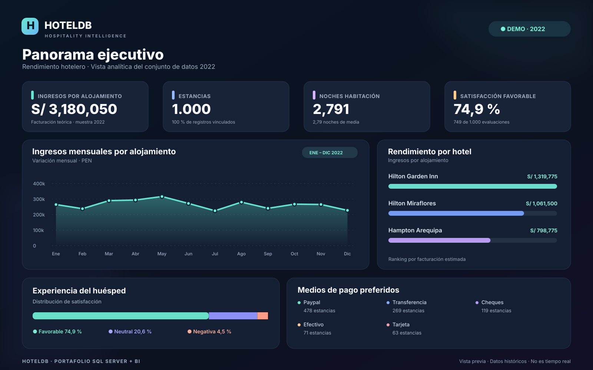

# HotelDB | Analítica hotelera con SQL Server y Power BI

**SQL Server · Business Intelligence · SQL Analytics · Data Quality · Interactive Dashboard**

  · [Perfil profesional de Henrry Ruiz Smith](https://github.com/Henrry-Ruiz-Smith)

### [▶ ABRIR DASHBOARD INTERACTIVO EN VIVO](https://henrry-ruiz-smith.github.io/HotelDB/)

**1.000 estancias** · **S/ 3.180.050** en ingresos estimados de alojamiento · **74,9 %** de satisfacción favorable · **2022**

[Explorar dashboard en vivo](https://henrry-ruiz-smith.github.io/HotelDB/) · [Ver código del dashboard](dashboard/) · [Consultar modelo y KPI](docs/MODELO_Y_KPIS.md) · [Abrir informe Power BI original](Power%20BI%20-%20Proyecto/PROYECTO%20INTEGRADOR.pbix)

> **Demo histórica (2022):** resultados calculados sobre datos de ejemplo. No son ingresos auditados ni indicadores en tiempo real. El archivo Power BI original se conserva.

## Sobre el proyecto

HotelDB es un proyecto de portafolio de **modelado relacional, calidad de datos, SQL analítico y visualización de indicadores hoteleros**. Incluye scripts reproducibles para SQL Server, cinco consultas de negocio, validaciones, un informe Power BI y un dashboard web público con filtros por hotel, mes y tipo de habitación.

**Qué demuestra:** modelado y consultas SQL, control de integridad, análisis de ingresos, indicadores de satisfacción y presentación ejecutiva orientada a decisiones.

> **Alcance:** demostración analítica; **no** es un PMS (Property Management System) productivo. No incluye API, autenticación, pagos en línea ni gestión transaccional de disponibilidad.

## Arquitectura de la demostración

HotelDB ofrece **dos rutas complementarias** sobre el mismo conjunto de datos sintéticos: consultas e informes sobre SQL Server, y una versión web autónoma que permite explorar los resultados sin instalar el motor ni Power BI.

\`\`\`mermaid
flowchart TD
    A["Datos de ejemplo · SQL 2022"]
    A --> B["SQL Server · modelo relacional"]
    B --> C["Vistas, validaciones y consultas de negocio"]
    C --> D["Power BI · informe original"]
    A --> E["Python · build_dashboard_data.py"]
    E --> F["data.js · datos anonimizados para demo"]
    F --> G["Dashboard HTML/JS · GitHub Pages"]
    style A fill:#0F172A,color:#FFFFFF,stroke:#38BDF8
    style B fill:#155E75,color:#FFFFFF,stroke:#38BDF8
    style C fill:#155E75,color:#FFFFFF,stroke:#38BDF8
    style D fill:#4C1D95,color:#FFFFFF,stroke:#A78BFA
    style E fill:#065F46,color:#FFFFFF,stroke:#34D399
    style F fill:#065F46,color:#FFFFFF,stroke:#34D399
    style G fill:#4C1D95,color:#FFFFFF,stroke:#A78BFA
\`\`\`

El dashboard web utiliza datos **precalculados** del seed histórico, por lo que no consulta SQL Server en tiempo real. La publicación en GitHub Pages contiene únicamente la carpeta <code>dashboard/</code>. Las validaciones automáticas comprueban contratos de estructura, coherencia del dataset web y reglas estáticas; no ejecutan consultas contra una instancia de SQL Server.

**Para evaluar el proyecto:** [dashboard interactivo](https://henrry-ruiz-smith.github.io/HotelDB/) · [scripts SQL](Querys/) · [pruebas](tests/) · [documentación de modelo y KPI](docs/MODELO_Y_KPIS.md).

## Dashboard ejecutivo

El dashboard web incluye indicadores KPI, evolución mensual de ingresos, comparaciones entre hoteles, satisfacción, preferencias de pago, consumibles, filtros interactivos y exportación CSV. La imagen superior es la vista previa estática; haz clic en ella para abrir la versión funcional publicada mediante GitHub Pages.

**Acceso directo:** https://henrry-ruiz-smith.github.io/HotelDB/ · [Documentación técnica del dashboard](dashboard/README.md)

## Stack

- **Microsoft SQL Server 2019+** y T-SQL.
- **SQL Server Management Studio (SSMS)** o **sqlcmd** para ejecutar los archivos SQL (procesan separadores de lote GO).
- **Power BI Desktop** para explorar el informe original.
- **Python 3.12** en GitHub Actions para validaciones estáticas del repositorio (no ejecuta SQL Server).

## Estructura real del repositorio

| Ruta | Función |
| --- | --- |
| [Querys/Creacion_Hotel.sql](Querys/Creacion_Hotel.sql) | Crea BDHOTEL y las 13 tablas con claves, tipos y controles básicos. |
| [Querys/lnsercion_Hotel.sql](Querys/lnsercion_Hotel.sql) | Inserta datos de ejemplo. **El primer carácter de lnsercion es una L minúscula**, conservado por compatibilidad. |
| [Querys/02_integridad_y_optimizacion.sql](Querys/02_integridad_y_optimizacion.sql) | Relaciona estancia–habitación–consumo, congela tarifa por noche, incorpora FKs e índices. |
| [Querys/Vistas.sql](Querys/Vistas.sql) | Publica vista_estancias (detalle de estancia/habitación) y vista_satisfacion (primer semestre de 2022). |
| [Querys/Consultas de Negocio.sql](Querys/Consultas%20de%20Negocio.sql) | Resuelve cinco preguntas de negocio con agregaciones y rankings. |
| [Querys/Validacion_Calidad.sql](Querys/Validacion_Calidad.sql) | Comprueba reglas críticas y reporta anomalías de habitación para inspección. |
| [Dataset/Dataset.xlsx](Dataset/Dataset.xlsx) | Dataset Excel de referencia. |
| [Power BI - Proyecto/PROYECTO INTEGRADOR.pbix](Power%20BI%20-%20Proyecto/PROYECTO%20INTEGRADOR.pbix) | Informe Power BI original, preservado sin modificaciones. |
| [docs/MODELO_Y_KPIS.md](docs/MODELO_Y_KPIS.md) | Diccionario de métricas, granularidad, limitaciones y guía de Power BI. |
| [tests/test_sql_assets.py](tests/test_sql_assets.py) | Validaciones estáticas de estructura y supuestos del proyecto. |

## Reproducción desde cero

**Requisito:** instancia de SQL Server 2019 o posterior y permisos para crear la base de datos. Ejecutar los archivos **en este orden**, en la **misma instancia**:

1. **Creacion_Hotel.sql** — crea la base y sus tablas.
2. **lnsercion_Hotel.sql** — carga datos de ejemplo en las tablas originales.
3. **02_integridad_y_optimizacion.sql** — vincula los registros a estancias concretas y agrega las restricciones e índices.
4. **Vistas.sql** — crea o actualiza las dos vistas de análisis.
5. **Validacion_Calidad.sql** — confirma integridad y muestra anomalías no destructivas.
6. **Consultas de Negocio.sql** — ejecuta las cinco consultas.

En SSMS, abrir cada script y ejecutarlo con F5 siguiendo el orden. Evitar ejecutar toda la carpeta por orden alfabético, ya que la carga debe ocurrir antes de la migración. **No ejecutar el seed por segunda vez sin limpiar previamente un entorno de pruebas**, porque inserta IDs fijos; los scripts de definición/migración contemplan reejecución, pero la carga no.

El script de migración no elimina registros ni transforma los archivos Excel/Power BI. La inferencia inicial de Id_Estancia solo es válida cuando cada cliente tiene exactamente **una estancia**. Si se intenta aplicar a datos reales con varias estancias por cliente, detiene la operación para exigir un mapeo explícito, en vez de asignar relaciones arbitrarias. Tras migrar, pueden existir varias estancias por cliente correctamente relacionadas mediante sus IDs.

### Cómo comprobar el resultado

En SSMS, luego del script de validación:

~~~sql
USE BDHOTEL;
SELECT TOP (10) * FROM dbo.vista_estancias;
SELECT * FROM dbo.vista_satisfacion;
~~~

La vista de estancias expone identificadores, fechas, noches, hotel, tipo, satisfacción, tarifa histórica e **Ingreso_Alojamiento**. El importe se calcula por **asignación de habitación** y **no** incluye consumibles. Las consultas de negocio documentan cómo se evitan duplicaciones.

## Qué análisis incluye

1. Hotel con menores ingresos por alojamiento y composición de su demanda de consumibles.
2. Tipo de habitación con mejor porcentaje de clientes muy satisfechos en cada hotel.
3. Medio de pago más utilizado por hotel.
4. Hotel con mayor porcentaje de encuestas favorables en el último trimestre de 2022.
5. Tipo de habitación con mayor facturación por hotel y año de entrada.

## Calidad de datos y limitaciones

Los archivos de carga contienen **1.000 clientes, 1.000 estancias, 1.000 habitaciones identificadas, 1.000 asignaciones y 1.000 consumos**. El conjunto tiene fechas de estancia de 2022. Los identificadores de habitación no representan necesariamente 1.000 habitaciones físicas: existen **solo 145 pares distintos (hotel, número de habitación)** y hay números repetidos en un mismo hotel. Esto impide calcular una tasa de ocupación física fiable sin depurar el inventario.

La tabla SATISFACCION no registra fecha de respuesta. Para los indicadores por semestre/trimestre se usa **Fecha_Entrada**, no la fecha real de encuesta. La tarifa se congela al ejecutar la migración, pero el seed original no registra el precio contractual histórico; se usa el precio del catálogo vigente en la carga. En el análisis por año los ingresos se asignan al año de entrada, sin repartir noches que crucen años.

**Power BI:** el archivo PBIX binario original permanece intacto. Después de ejecutar los scripts, abrirlo en Power BI Desktop, actualizar credenciales/origen y comprobar las medidas antes de publicar. Consultar la guía de granularidad y DAX en [MODELO_Y_KPIS.md](docs/MODELO_Y_KPIS.md). No se afirma haber validado ni regenerado ese informe.

## Calidad automatizada

Ejecutar las comprobaciones estáticas con:

~~~bash
python -m unittest discover -s tests -v
~~~

GitHub Actions ejecuta esta suite en cada push y pull request. Estas pruebas verifican rutas, contratos analíticos y características del seed, pero **no sustituyen una ejecución real en SQL Server**. También se incluye Validacion_Calidad.sql para verificaciones de datos dentro del motor.

## Próximos pasos

Normalizar el inventario físico (eliminar identificadores duplicados a nivel de habitación real), registrar fechas reales de encuestas y precios contractuales desde el origen, versionar el modelo del PBIX como PBIP, incorporar pruebas de integración SQL Server en CI y definir políticas de acceso antes de cualquier uso con datos de personas reales.
